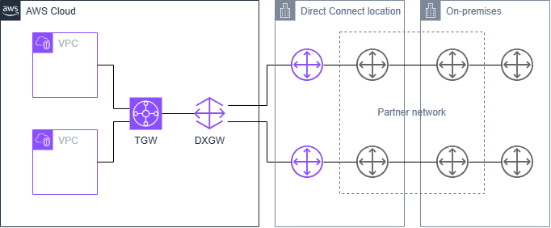

## はじめに

[NW-JAWS DAY 2026のAWS Direct Connect Resiliency Workshop](https://jawsug-nw.connpass.com/event/407644/)に参加してきたのでそれについてです。

Direct Connectは「VPCはDirect Connect経由でオンプレミスと接続されています。」の一言で片づけられがちで、名前は聞いたことがあるけどよくわからない筆頭みたいな存在と個人的には思っています。

そんな不思議なDirect Connectですが、ワークショップが開催されるということで参加してきました。

## ワークショップのストーリー

ワークショップでは以下のようなトポロジーのネットワークを構築し、BGPのパラメータを用いて経路の優先順位などを制御する方法を実際に手を動かして確認していきました。[^1]

[^1]: ワークショップのマテリアルを転載するのはダメということなので、私の方でアレンジして作成しています。

### AWS環境の準備

二つのVPCがTransit Gatewayに接続されているので、

1. Direct Connect Gatewayを作成してTransit Gatewayと関連付ける（AWSコンソール）
2. Direct Connectパートナーに申請して、ホスト型接続を作成する
3. 作成された接続をアタッチするVIFを作成する（AWSコンソール）

の流れで作業を行います。

ここまでの作業で（Direct Connectパートナーがよしなにしてくれるおかげもあり）L2の接続性が確保されます。

逆に言うと、AWSコンソールで何かの作業が出来るのはここまでです。
ここから先はBGPで経路制御を行います。

### BGPのパラメータを用いた経路の優先順位の制御

Direct Connectでは以下の4つで経路の優先順位を制御できるようになっています。

1. BGPコミュニティ属性
2. AS_PATHプリペンド
3. ローカルプリファレンス
4. Multi-Exit Discriminator

ワークショップでは、BGPコミュニティ属性・AS_PATHプリペンド・ローカルプリファレンスを使用して優先度の設定を行っていきます。

ちなみに、特に優先順位を設定しない場合、今回の構成では経路が2つあるのでトラフィックが二つの経路を分散して流れます。
この場合、一般的なECMPと同じように往路と復路で経路が異なる場合が出てきます。
ステートフルなファイアーウォールを置いている場合だと、この挙動はあまりよろしくないかもしれません。

#### BGPコミュニティ属性

BGPコミュニティ属性では、以下のタグを経路に付けて広告することでAWS側の優先順位（Local preference）を制御することが出来ます。

|BGPコミュニティタグ|優先順位|
|:-|:-|
|`7224:7300`|高|
|`7224:7200`|中|
|`7224:7100`|低|

当然ですが、制御しているのはAWS側の優先度なのでこちらから発信する経路の優先度には何の影響もありません。

#### AS_PATHプリペンド

一般的なBGPと同様にこちらから広告している経路のASパスに追加することで、広告している経路の優先度を下げることが出来ます。

#### ローカルプリファレンス

BGPコミュニティ属性とAS_PATHプリペンドはAWS側から送る経路の優先度を制御するものでしたが、ローカルプリファレンスはこちらから送る経路を制御できます。

このあたりも一般的なBGPと一緒です。

#### Multi-Exit Discriminator

ワークショップでは取り上げられませんでしたが、MEDを使用しても優先度を制御できるようです。
ただし、[AWSのドキュメントでは推奨はしていない](https://docs.aws.amazon.com/directconnect/latest/UserGuide/routing-and-bgp.html#private-routing-policies)ようです。

## おわりに

Direct Connect GatewayやVIFの作成はAWS固有の作業ですが、その先の経路の制御はBGPを通じて行います。
そのため、カスタマールーターとしてVyOSを使っているのもありワークショップの後半はVyOSのハンズオンなんじゃないかと錯覚するレベルでひたすらVyOSのコマンドを叩いていました。

VyOSを少しでもかじったことのある人であれば、設定済みのコンフィグをのぞいてみるとより理解が深まりそうです。

また、AWS側のローカルプリファレンスはAWSコンソールで操作できた方が良いのではと一瞬考えましたが、既存のネットワークの自動化に載せるなら自ルータから制御が出来た方が都合がいいのかもしれません。
AS_PATHプリペンドはルータからやるのに、AWS側のローカルプリファレンスはAPIを叩いたりとかは違和感がありますしね。

おわり
